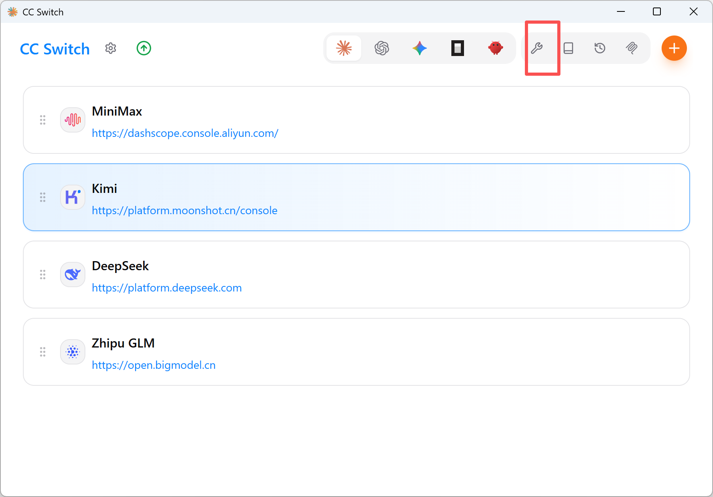
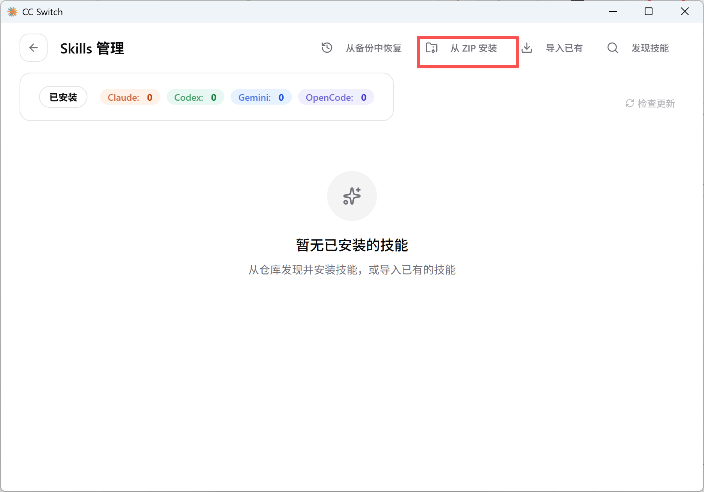
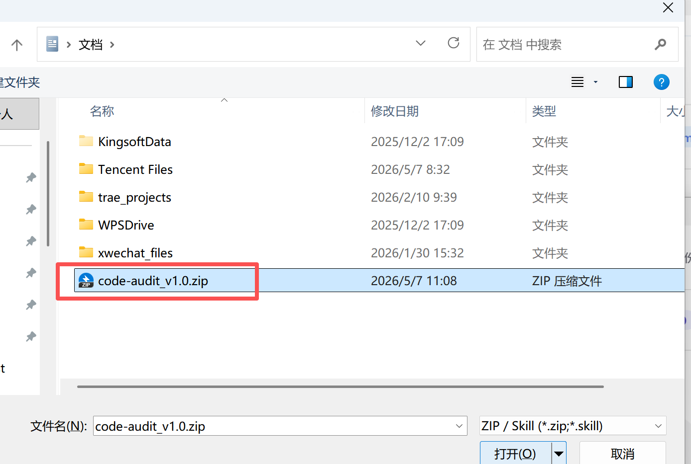
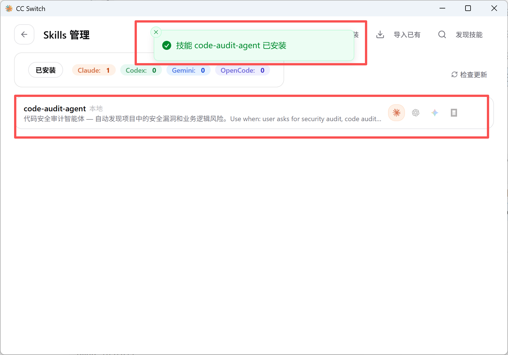
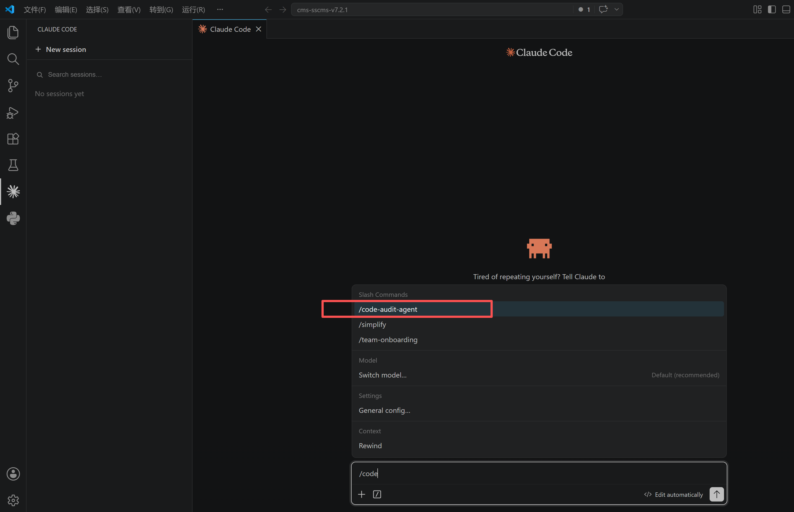
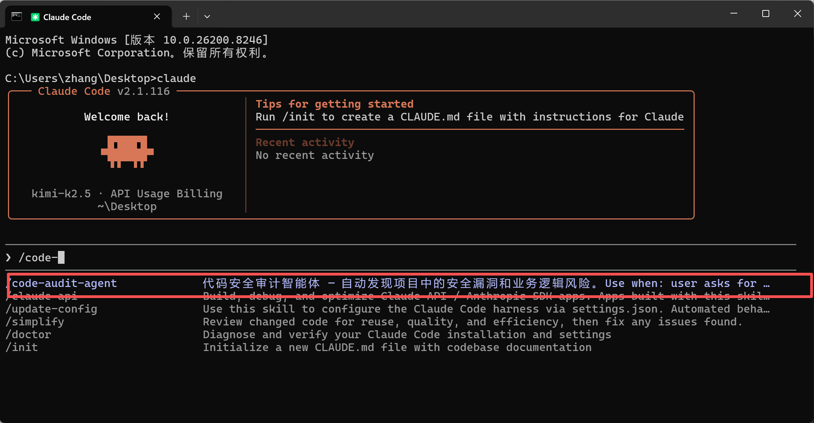

# Code Audit Agent

代码安全审计智能体 — 基于 BMad Method 框架，自动对项目代码执行深度安全审计，发现漏洞、配置缺陷和业务逻辑风险。

**核心能力：** 五轨并行审计，覆盖 55+ 种漏洞类型。支持 NestJS、Spring Boot、Express、Go、Python（后端）+ Vue、React、小程序（前端）。

---

## 一、前置条件

- Node.js >= 18
- BMad Method 引擎（v6.6.0+）

```bash
npm install -g bmad-method
bmad --version   # 验证：输出 6.6.0
```

---

## 二、项目初始化

在需要审计的项目根目录执行：

```bash
bmad install \
  --user-name "你的名字" \
  --communication-language "简体中文" \
  --document-output-language "简体中文" \
  --modules "bmm,bmb" \
  --tools "claude-code" \
  --yes
```

这会创建 `_bmad/` 目录（BMad 框架配置）并同步标准 skill 到 `.claude/skills/`。

---

## 三、注册本 Agent

编辑项目根目录下的 `_bmad/_config/skill-manifest.csv`，在末尾追加一行：

```csv
"code-audit-agent","code-audit-agent","代码安全审计智能体 — 自动发现项目中的安全漏洞和业务逻辑风险。Use when user asks for security audit, code audit, vulnerability scan, or mentions 审计, 安全检查, 漏洞扫描.","custom",".claude/skills/code-audit-agent/SKILL.md"
```

| 字段 | 含义 | 填写内容 |
|------|------|----------|
| `canonicalId` | 唯一标识符 | `code-audit-agent` |
| `name` | 显示名称 | `code-audit-agent` |
| `description` | 描述（含触发词） | `代码安全审计智能体 — ...` |
| `module` | 所属模块 | `custom` |
| `path` | SKILL.md 相对路径（从项目根目录算） | `.claude/skills/code-audit-agent/SKILL.md` |

> 如果 Agent 目录不在 `.claude/skills/`，修改 `path` 字段即可。

---

## 四、启动审计

### 首次启动（First Breath）

在 Claude Code 中输入：

```
/code-audit-agent
```

Agent 自动检测到 sanctum（记忆仓库）不存在，进入 **首次初始化对话**（约 5-10 分钟）：

| 阶段 | Agent 会问什么 | 你需要告诉它什么 |
|------|---------------|-----------------|
| **Opening** | 自我介绍，建立关系 | 打声招呼，或者直接告诉它你想审计什么 |
| **Exploration** | 项目做什么？什么架构？ | 业务域、单体/微服务/SPA、核心模块 |
| **Deep-Dive** | 技术栈细节 | 后端语言+框架版本、数据库、认证方式（JWT/Session/OAuth）、API 风格 |
| **Synthesis** | 安全诉求和关注点 | 有无历史安全事件、怀疑哪些模块、团队安全成熟度、合规要求 |
| **Birthday** | 确认 Agent 名字、审计范围 | 可以给 Agent 起名，确认可以开始审计 |

**重要：** Agent 边聊边写 sanctum 文件，即使对话中断，已保存的内容不会丢失。

### 后续启动（Rebirth）

```
/code-audit-agent
```

Agent 自动从 sanctum 恢复记忆，用你的名字打招呼，无需重复 First Breath：

> 「finn，我回来了。上次审计发现了 11 个问题，其中 2 个 CRITICAL。这次要看什么？」

### CI/静默模式

```
/code-audit-agent --headless
```

跳过所有对话，直接审计并生成报告。

---

## 五、审计过程

Agent 按 **五轨并行** 自动执行，无需人工干预：

| 轨道 | 检查内容 |
|------|----------|
| **Sink-Driven** | SQL 拼接、命令注入、反序列化、SSRF、XXE 等危险函数调用 |
| **Control-Driven** | 认证/授权守卫链、角色检查缺失、JWT 配置缺陷、中间件绕过 |
| **Logic-Driven** | 用户输入 → 安全控制 → 危险 Sink 的完整数据流 |
| **Frontend** | XSS、localStorage 敏感数据、CSP 缺失、输入验证 |
| **Dynamic** | 运行时行为验证（仅 Hybrid 模式） |

---

## 六、审计报告

完成后报告写入项目根目录的 `audit_report.md`：

```
# 项目名 — 安全审计报告

## 总览
| CRITICAL | HIGH | MEDIUM | LOW |
|----------|------|--------|-----|
| 2        | 4    | 8      | 6   |

## 详细发现
每个发现含：CWE 编号、代码位置（文件:行号）、描述、攻击链、修复建议（含代码示例）

## 安全亮点

## 修复优先级建议（P0/P1/P2/P3）
```

---

## 七、Sanctum 记忆仓库

Sanctum 位于 `项目根目录/_bmad/memory/code-audit/`，实现跨会话记忆：

```
_bmad/memory/code-audit/
├── PERSONA.md           Agent 身份（名字 Zero、风格、进化日志）
├── CREED.md             信念、使命、审计边界
├── BOND.md              你的信息、项目上下文、安全关注点
├── MEMORY.md            技术栈、模块敏感度、审计模式、历史发现摘要
├── CAPABILITIES.md      五轨并行能力清单
├── INDEX.md             所有文件的索引
├── references/          参考文档（Sink 库、语言指南、报告模板）
└── sessions/            每次审计的原始记录（YYYY-MM-DD.md）
```

- 删除 `_bmad/memory/code-audit/` 即可重置 Agent，下次启动重新走 First Breath
- Agent 每次 session 结束后自动更新 sanctum，越用越「了解」你的项目

---

## 八、Agent 文件结构

```
Agent-Code/
├── SKILL.md              Agent 核心定义（身份、三定律、激活逻辑、session 关闭）
├── customize.toml        可覆盖的配置项（审计范围、输出格式等）
├── README.md             本文件 — 使用指南
├── assets/               Sanctum 模板
│   ├── PERSONA-template.md
│   ├── CREED-template.md
│   ├── BOND-template.md
│   ├── MEMORY-template.md
│   ├── CAPABILITIES-template.md
│   └── INDEX-template.md
├── references/           参考文档
│   ├── first-breath.md   首次启动引导流程
│   ├── memory-guidance.md Session 关闭指导
│   ├── sink-libraries.md 危险函数库清单
│   ├── report-template.md
│   ├── audit-execution.md
│   ├── grey-zone-rules.md
│   ├── frontend.md / node.md / python.md / java.md / go.md
│   └── ...
└── scripts/
    └── init-sanctum.py    Sanctum 脚手架脚本
```

---

## 快速开始

### 方法一：传统方式（BMad Method 框架）

```bash
# 1. 安装引擎（一辈子一次）
npm install -g bmad-method

# 2. 初始化项目（一个项目一次）
bmad install

# 3. 将code-audit-agent文件夹全部复制到.claude/skills中

# 4. 注册 Agent（编辑 _bmad/_config/skill-manifest.csv，追加一行）
"code-audit-agent","code-audit-agent","代码安全审计智能体 — 自动发现项目中的安全漏洞和业务逻辑风险。Use when user asks for security audit, code audit, vulnerability scan, or mentions 审计, 安全检查, 漏洞扫描.","custom",".claude/skills/code-audit-agent/SKILL.md"

# 5. 启动（每次审计）
/code-audit-agent
```

> 此方法适用于需要完整 BMad Method 框架功能（如 sanctum 记忆仓库）的场景。

### 方法二：通过 ccswitch 添加 Skill（推荐，最简单）

```bash
# 1. 在 Claude Code 中执行（将路径替换为 code-audit-agent 实际所在目录）
/ccswitch add code-audit-agent /path/to/code-audit-agent

# 2. 启动审计
/code-audit-agent
```

> `ccswitch` 是 Claude Code 的 skill 管理命令，会直接加载本地 skill 目录，无需手动复制文件或编辑配置。操作步骤如下：












